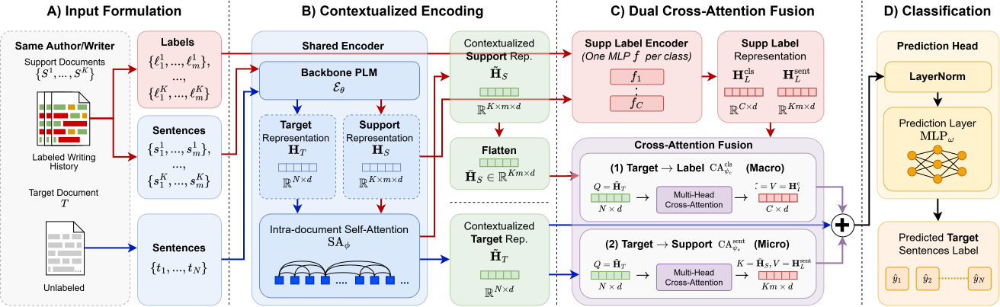

<h1 align="center">
  Personalization over Generalization: History-Aware Sentence-Level AI Detection in Collaborative Writing
</h1>

<div align="center">
  <a href="https://aclanthology.org/2026.emnlp-main.1282/"></a>
  <a href="https://aclanthology.org/2026.emnlp-main.1282/"></a>
  <a href="https://www.python.org/downloads/release/python-31112/"></a>
  <a href="LICENSE"></a>
  <a href="dataset/LICENSE"></a>
</div>

<br>



Sentence-level AI detectors are essential for detecting AI misuse in human-AI collaborative writing. Yet existing approaches still treat all authors identically, ignoring individual writing styles. This is a critical oversight, given that the boundary between human and AI text is inherently author-specific. To address this limitation, we propose PHAS-ID (Personalized History-Aware Sentence-level AI Detector), an approach that introduces personalization to sentence-level detection. By matching target sentences against the author{'}s history of labeled documents, PHAS-ID tailors its predictions based on prior writing behaviors. Furthermore, current synthetic datasets for this task fail to capture realistic collaborative patterns, which we address by introducing GhostFill, a style-aware synthetic dataset generation pipeline. Our experiments demonstrate that PHAS-ID outperforms the previous state-of-the-art (SOTA) across seen-author, unseen-author, cross-domain, and cross-generator settings. Ablation studies confirm that these improvements stem from genuine author-specific personalization rather than the mere addition of context. Our source code and dataset are available at our GitHub repository.


---

## Table of Contents

1. [Environment Setup](#1-environment-setup)
2. [Repository Structure](#2-repository-structure)
3. [Datasets](#3-datasets)
4. [PHAS-ID Experiments (CoAuthor)](#4-phas-id-experiments-coauthor)
   - [Seen-Author Setting](#41-seen-author-setting)
   - [Unseen-Author Setting](#42-unseen-author-setting)
   - [Global-Author Setting](#43-global-author-setting)
   - [Cross-Domain Settings](#44-cross-domain-settings)
   - [Cross-Generator Setting](#45-cross-generator-setting)
5. [PHAS-ID Experiments (HACo-Det)](#5-phas-id-experiments-haco-det)
6. [GhostFill Dataset Generation](#6-ghostfill-dataset-generation)
7. [Personalized LLM Baseline](#7-personalized-llm-baseline)
8. [Evaluation (Standalone)](#8-evaluation-standalone)
9. [License](#9-license)
10. [Citation](#10-citation)

---

## 1. Environment Setup

### Prerequisites

- Python **3.11.12** (same as `pyproject.toml` pins this version)
- CUDA 12.4 with a compatible GPU (required for `flash-attn` and `faiss-gpu-cu12`)
- [`uv`](https://github.com/astral-sh/uv) package manager

### Install `uv`

```bash
curl -LsSf https://astral.sh/uv/install.sh | sh
```

Then restart your terminal.

### Install dependencies

```bash
uv sync
```

### API key (required for GhostFill generation and PLLM baseline)

Create or modify `.env` file in the project root:

```txt
OPENROUTER_API_KEY=YOUR_KEY_HERE
```

Obtain a key at [openrouter.ai](https://openrouter.ai). This is only required for the GhostFill generation and baseline PLLM experiments. PHAS-ID training/evaluation does not need it.

---

## 2. Repository Structure

```
.
├── phas_id_train.py          # Train PHAS-ID
├── phas_id_eval.py           # Standalone evaluation of a trained checkpoint
├── ghostfill_generate.py     # Generate the GhostFill dataset (requires API key)
├── build_ghostfill_csv.py    # Convert GhostFill JSONL outputs to a single CSV
├── baseline_pllm.py          # Personalized LLM baseline
├── utils/
│   ├── console.py            # Logging utilities
│   ├── openrouter.py         # OpenRouter utilities
│   └── parse_hacodet.py      # Convert raw HACo-Det JSON files to CSV
├── src/
│   ├── phas_id/              # Model, dataset, data module, training module
│   └── ghostfill/            # GhostFill generation pipeline
└── dataset/
    ├── coauthor/                          # CoAuthor dataset (included)
    │   ├── raw.csv                        # Seen-author split
    │   ├── unseen_authors.csv             # Unseen-author split
    │   ├── global_author.csv              # Global-author split
    │   ├── cross_domain_arg_to_cre.csv    # Cross-domain: Argumentative → Creative
    │   └── cross_domain_cre_to_arg.csv    # Cross-domain: Creative → Argumentative
    ├── ghostfill/                         # Pre-generated GhostFill data (included)
    │   ├── anthropic_claude-sonnet-4.6/
    │   ├── deepseek_deepseek-v4-flash/
    │   ├── openai_gpt-5.4/
    │   └── raw.csv                        # Aggregated CSV (build with build_ghostfill_csv.py)
    ├── blogspot/                          # Blogspot corpus (we gave sample data, full data must be downloaded manually)
    └── hacodet/                           # HACo-Det (must be downloaded and parsed manually)
```

---

## 3. Datasets

### CoAuthor

Already included in `dataset/coauthor/`.

### GhostFill

Pre-generated outputs are included in `dataset/ghostfill/` (one subdirectory per LLM). The aggregated `dataset/ghostfill/raw.csv` is also included. To regenerate from scratch, see [Section 6](#6-ghostfill-dataset-generation).

### HACo-Det (download required)

HACo-Det is not included due to size. Download the raw data from their official repository.

Arrange the downloaded files by yourself so the directory layout is:

```
dataset/hacodet/raw/
├── <model_A>/
│   ├── <domain>_<model>_train.json
│   ├── <domain>_<model>_test.json
│   └── ...
└── <model_B>/
    └── ...
```

For example:
```
dataset/hacodet/raw/
├── gpt-4o/
│   ├── news_gpt-4o_train.json
│   ├── news_gpt-4o_test.json
│   └── ...
└── llama/
    └── ...
```

Then parse it into a CSV (see [Section 5](#5-phas-id-experiments-haco-det)).

### Blogspot (Sample data included, full data must be downloaded)

This dataset is only needed for GhostFill generation. We include a small sample in `dataset/blogspot/blogtext_sample.csv` for testing, but to run the full GhostFill generation you must download the Blogspot blog corpus (`blogtext.csv`) from their official Kaggle.

Place the downloaded files at:

```
dataset/blogspot/blogtext.csv
```

---

## 4. PHAS-ID Experiments (CoAuthor)

All training runs automatically evaluate on the test set at the end using the best checkpoint. Logs are written to `logs/phas_id/<run_id>/` and model checkpoints to `weights/phas_id/<run_id>/`.


### Key arguments (`phas_id_train.py`)

| Argument | Default | Description |
|---|---|---|
| `-ra_p` / `--raw_data_path` | `dataset/coauthor/raw.csv` | Path to the raw dataset CSV |
| `-pa_p` / `--parsed_data_path` | `dataset/coauthor/parsed_phas_id.jsonl` | Path to the parsed data cache |
| `-d` / `--dataset` | `coauthor` | Dataset type: `coauthor` (3-class) or `hacodet` (binary) |
| `-r` / `--recreate` | — | Force re-parsing of the raw data |
| `-mn` / `--model_name` | `microsoft/deberta-v3-base` | HuggingFace encoder backbone |
| `-K` / `--K` | `5` | Number of support documents per episode |
| `-uln` / `--unfreeze_last_n` | `2` | Number of encoder layers unfrozen from the top |
| `-dal` / `--doc_attn_layers` | `1` | Number of intra-document attention layers |
| `-tl` / `--token_limit` | `128` | Max tokens per sentence |
| `-lr` / `--lr` | `2e-5` | Learning rate |
| `-dr` / `--dropout` | `0.0` | Dropout rate |
| `-me` / `--max_epochs` | `20` | Maximum training epochs |
| `-p` / `--patience` | `3` | Early stopping patience |
| `-sp` / `--model_save_path` | `weights/phas_id` | Directory to save checkpoints |
| `-lp` / `--log_path` | `logs/phas_id` | Directory to save CSV logs |
| `--seed` | `42` | Random seed |

### 4.1 Seen-Author Setting

Authors in the test set were seen during training (standard in-distribution evaluation).

```bash
uv run phas_id_train.py \
  -ra_p dataset/coauthor/raw.csv \
  -pa_p dataset/coauthor/parsed_phas_id_seen.jsonl \
  -d coauthor
```

### 4.2 Unseen-Author Setting

Test authors do not appear in the training split.

```bash
uv run phas_id_train.py \
  -ra_p dataset/coauthor/unseen_authors.csv \
  -pa_p dataset/coauthor/parsed_phas_id_unseen.jsonl \
  -d coauthor
```

### 4.3 Global-Author Setting

A single global "author" identity is used for all episodes (no author-specific personalisation).

```bash
uv run phas_id_train.py \
  -ra_p dataset/coauthor/global_author.csv \
  -pa_p dataset/coauthor/parsed_phas_id_global.jsonl \
  -d coauthor
```

### 4.4 Cross-Domain Settings

Train and test on documents from different writing domains.

**Argumentative → Creative** (train on argumentative essays, test on creative writing):

```bash
uv run phas_id_train.py \
  -ra_p dataset/coauthor/cross_domain_arg_to_cre.csv \
  -pa_p dataset/coauthor/parsed_phas_id_cross_arg_to_cre.jsonl \
  -d coauthor
```

**Creative → Argumentative** (train on creative writing, test on argumentative essays):

```bash
uv run phas_id_train.py \
  -ra_p dataset/coauthor/cross_domain_cre_to_arg.csv \
  -pa_p dataset/coauthor/parsed_phas_id_cross_cre_to_arg.jsonl \
  -d coauthor
```

### 4.5 Cross-Generator Setting

Train on CoAuthor (seen-author), then evaluate on GhostFill, which contains documents from LLMs not seen during training. GhostFill is a binary dataset (Human / AI), so pass `--binary_output` during evaluation.

**Step 1 — Train on CoAuthor:**

```bash
uv run phas_id_train.py \
  -ra_p dataset/coauthor/raw.csv \
  -pa_p dataset/coauthor/parsed_phas_id_seen.jsonl \
  -d coauthor \
  -sp weights/phas_id_cross_gen
```

At the end of training, note the `<run_id>` printed in the console (e.g., `a1b2c3d4`). The best checkpoint will be at:

```
weights/phas_id_cross_gen/<run_id>/epoch=X-step=Y.ckpt
```

**Step 2 — Evaluate on GhostFill:**

```bash
uv run phas_id_eval.py \
  -ra_p dataset/ghostfill/raw.csv \
  -pa_p dataset/ghostfill/parsed_phas_id.jsonl \
  -d coauthor \
  -ckpt weights/phas_id_cross_gen/<run_id>/epoch=X-step=Y.ckpt \
  --binary_output
```

Replace `<run_id>/epoch=X-step=Y.ckpt` with the actual checkpoint filename from Step 1.

---

## 5. PHAS-ID Experiments (HACo-Det)

### Step 1 — Parse HACo-Det

After downloading and placing the raw files (see [Section 3](#3-datasets)):

```bash
uv run parse_hacodet.py \
  --raw_data_path dataset/hacodet/raw \
  --parsed_data_path dataset/hacodet/raw.csv \
  --chunk_size 128
```

This produces `dataset/hacodet/raw.csv` with sentence-level labels (`0` = Human, `1` = AI).

### Step 2 — Train

HACo-Det is a binary classification task (`-d hacodet` switches the model to 2 output classes):

```bash
uv run phas_id_train.py \
  -ra_p dataset/hacodet/raw.csv \
  -pa_p dataset/hacodet/parsed_phas_id.jsonl \
  -d hacodet
```

---

## 6. GhostFill Dataset Generation

GhostFill generates human-AI collaborative documents by selecting real human authors from the Blogspot corpus, extracting their writing style, matching them to CoAuthor collaboration patterns, and using an LLM to fill in deleted sentences.

**Prerequisites:**
- `dataset/blogspot/blogtext.csv` downloaded from Kaggle, or use `dataset/blogspot/sample.csv` for quick testing via `--blogspot_path`.
- `OPENROUTER_API_KEY` set in `.env`

### Step 1 — Generate JSONL for one LLM

```bash
uv run ghostfill_generate.py \
  --model anthropic/claude-sonnet-4-6 \
  --k 10 \
  --docs_per_author 10 \
  --workers 4 \
  --output_dir dataset/ghostfill
```

Example of using sample data:

```bash
uv run ghostfill_generate.py \
  --model "deepseek/deepseek-v4-flash" \
  --k 10 \
  --docs_per_author 10 \
  --workers 4 \
  --output_dir dataset/ghostfill \
  --blogspot_path dataset/blogspot/sample.csv
```

Key arguments:

| Argument | Default | Description |
|---|---|---|
| `--model` | *(required)* | OpenRouter model identifier (e.g., `openai/gpt-5.4`, `deepseek/deepseek-v4-flash`) |
| `--k` | `10` | Number of Blogspot authors to select |
| `--docs_per_author` | `10` | Documents per author |
| `--seed` | `42` | Random seed |
| `--workers` | `4` | Parallel LLM API workers |
| `--output_dir` | `dataset/ghostwriter` | Base output directory |
| `--blogspot_path` | `dataset/blogspot/blogtext.csv` | Path to Blogspot CSV (use `dataset/blogspot/sample.csv` for testing) |
| `--coauthor_path` | `dataset/coauthor/raw.csv` | Path to CoAuthor CSV |
| `--no_resume` | — | Discard saved intermediate results and recompute |

The script is resumable: re-running with the same arguments will skip already-processed documents.

Output is written to `dataset/ghostfill/<model_slug>/dataset.jsonl`.

### Step 2 — Build aggregated CSV

After generating data for one or more models, aggregate all JSONL files into a single CSV for use with PHAS-ID:

```bash
uv run build_ghostfill_csv.py
```

This writes `dataset/ghostfill/raw.csv` (all documents marked as `train_ix=test`).

---

## 7. Personalized LLM Baseline

The PLLM baseline prompts a large language model with per-author support documents (few-shot) and asks it to classify each sentence in the target document.

**Requires:** `OPENROUTER_API_KEY` set in `.env`.

### CoAuthor (seen-author, 3-class)

```bash
uv run baseline_pllm.py \
  -ra_p dataset/coauthor/raw.csv \
  -pa_p dataset/coauthor/parsed_phas_id_seen.jsonl \
  --dataset coauthor \
  --llm openai/gpt-4o \
  --K 5 \
  --output_path logs/llm_baseline
```

Key arguments:

| Argument | Default | Description |
|---|---|---|
| `--llm` | `openai/gpt-4o` | OpenRouter model identifier |
| `--K` | `5` | Number of support documents per episode |
| `--dataset` | `coauthor` | `coauthor` (3-class) or `hacodet` (binary) |
| `--output_path` | `logs/llm_personalized_baseline` | Where to save predictions and metrics |
| `--recreate` | — | Force re-parsing of the raw data |

Results are saved as `<output_path>/<llm_slug>_predictions.csv` and `<llm_slug>_metrics.json`.

---

## 8. Evaluation (Standalone)

Use `phas_id_eval.py` to evaluate any saved checkpoint on any compatible dataset without re-training.

```bash
uv run phas_id_eval.py \
  -ra_p <path/to/raw.csv> \
  -pa_p <path/to/parsed.jsonl> \
  -d <coauthor|hacodet> \
  -ckpt <path/to/checkpoint.ckpt> \
  --log_path logs/phas_id_eval
```

Key arguments:

| Argument | Default | Description |
|---|---|---|
| `-ra_p` | `dataset/coauthor/raw.csv` | Raw dataset CSV |
| `-pa_p` | `dataset/coauthor/parsed_phas_id.jsonl` | Parsed data cache |
| `-d` | `coauthor` | Dataset type (`coauthor` or `hacodet`) |
| `-ckpt` | *(required)* | Path to the `.ckpt` checkpoint |
| `-K` | `5` | Support documents per episode (must match training) |
| `--binary_output` | — | Collapse 3-class predictions to binary (Human vs AI+AI-Human) |
| `--log_path` | `logs/phas_id_eval` | Output directory for evaluation logs |

---

## 9. License

- **Code** (everything outside `data/`): [MIT License](LICENSE)
- **Dataset** (`dataset/`): [CC BY-NC 4.0](dataset/LICENSE). Non-commercial use only, attribution required.

---

## 10. Citation

If you find our codes or paper useful, please consider giving us a star or citing our work.

```bibtex
@inproceedings{adi-etal-2026-personalization,
    title = "Personalization over Generalization: History-Aware Sentence-Level {AI} Detection in Collaborative Writing",
    author = "Adi, Rizky  and
      Suzuki, Yoshimi  and
      Fukumoto, Fumiyo",
    editor = "Lee, Hung-Yi  and
      Dev, Sunipa  and
      Li, Jessy  and
      Elliott, Desmond",
    booktitle = "Proceedings of the 2026 Conference on Empirical Methods in Natural Language Processing",
    month = oct,
    year = "2026",
    address = "Budapest, Hungary",
    publisher = "Association for Computational Linguistics",
    url = "https://aclanthology.org/2026.emnlp-main.1282/",
    pages = "29217--29235",
    ISBN = "979-8-89176-459-0"
}
```
